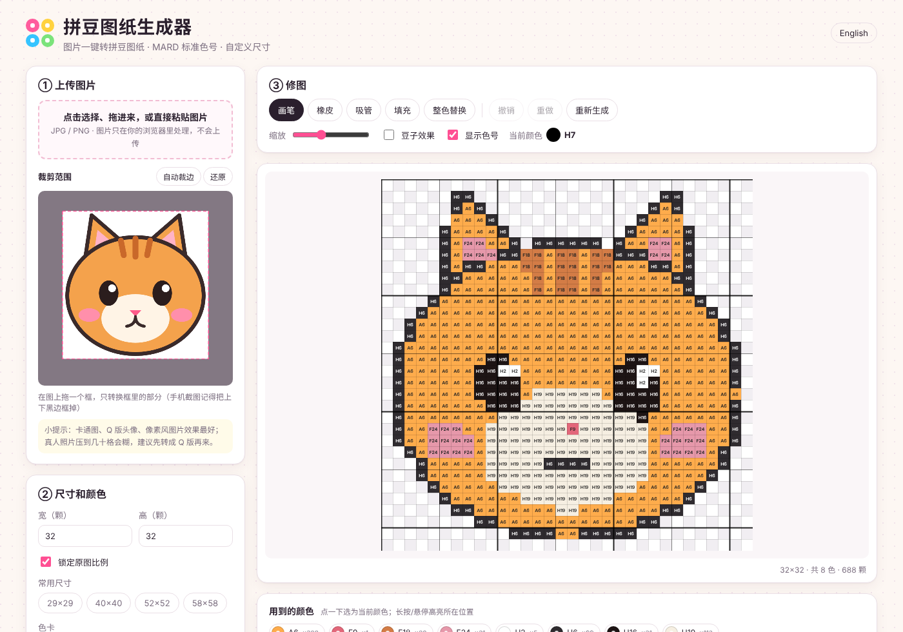
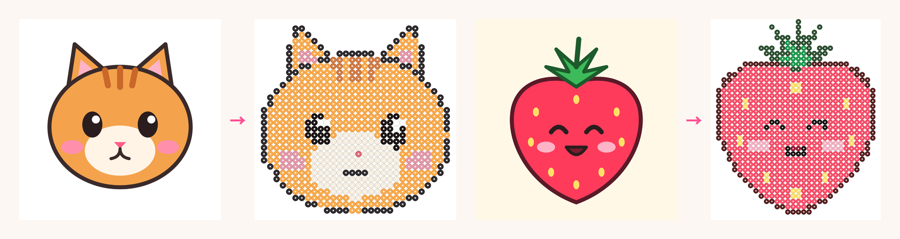
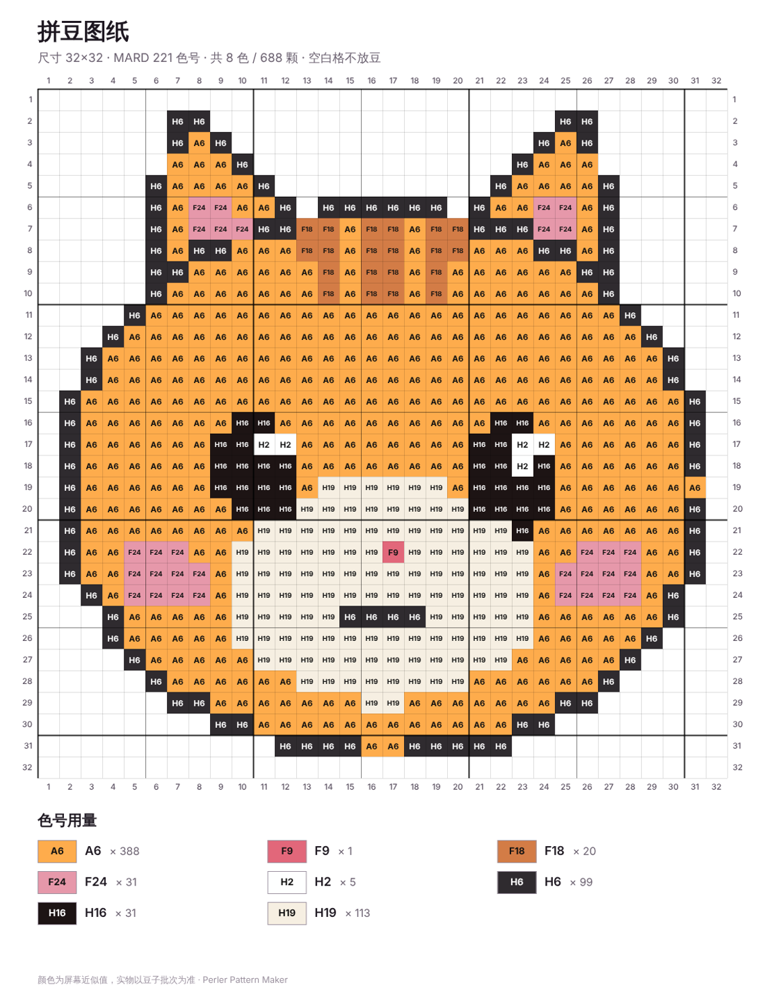

# 拼豆图纸生成器 · Perler Pattern Maker

图片一键转拼豆图纸：**MARD 221 标准色号**、自定义尺寸、可手动修图，导出带色号和用量表的图纸。
Turn any image into a Perler / fuse-bead pattern with **MARD 221 standard colour codes**, any size, manual editing, and a printable chart with bead counts.

**在线使用 / Try it:** https://hazelnutnuut.github.io/perler-pattern-maker/



**效果示例 / Examples**（原图 → 32 颗宽的拼豆效果 / original → 32-bead-wide result）



导出的图纸 / Exported chart:



示例图在 `docs/examples/`，可以直接拿来试。 Example images are in `docs/examples/` — try them out.

---

## 中文

### 功能
- **上传图片**：点击选择、拖拽或直接粘贴（Ctrl/⌘+V）。图片只在浏览器本地处理，不上传任何服务器。
- **裁剪**：在图上拖框选择范围；「自动裁边」会去掉纯色边和手机截图的黑色 UI 边。
- **自定义尺寸**：输入宽×高（5–200 颗），可锁定原图比例，或选 29×29 / 40×40 / 52×52 / 58×58。
- **标准色号**：内置 MARD 221 色卡，用 CIEDE2000 色差公式匹配最接近的色号（比直接比 RGB 更接近人眼感觉，肤色尤其明显）。
- **控制颜色数**：
  - 「最多颜色数」：超过就把用量最少的颜色并入最接近的颜色。
  - 「相近色合并」：把几乎一样的颜色（比如三四种黑）合成一种，少买几种豆。
- **自动去背景**：从图片边缘开始，把和背景色相近、并且连通的格子变成空格（不放豆），所以人物内部的白色不会被误删。
- **两种取色方式**：主色（适合卡通、线条清晰）／平均色（适合照片）。
- **手动修图**：画笔、橡皮、吸管、填充、整色替换，支持撤销/重做（⌘/Ctrl+Z）。鼠标悬停在「用到的颜色」上会高亮它在图里的位置。
- **导出**：
  - 图纸 PNG：每格印色号、四边坐标、每 5/10 格粗线、色号用量表
  - 豆子效果图 PNG
  - 打印 / 存为 PDF
  - CSV（每格色号，方便放进 Excel）
- **板子分割线**：按 29 或 52 的板子画虚线，方便分板拼。
- **中英双语界面**。

### 小贴士
- 卡通图、Q 版头像、像素风图片效果最好。真人照片压到几十格会糊，建议先用 AI 转成 Q 版再来。
- 几十格的小尺寸里，眼睛和嘴通常需要用画笔手动修一下。
- 色号的 HEX 值是屏幕近似值，实物颜色会受豆子批次和光线影响，买豆前最好对照实物色卡。

### 本地运行
纯静态网页，没有构建步骤：
```bash
git clone https://github.com/Hazelnutnuut/perler-pattern-maker.git
cd perler-pattern-maker
python3 -m http.server 8000
# 打开 http://localhost:8000
```
（需要用本地服务器打开，直接双击 index.html 的话浏览器会拦截 ES module。）

---

## English

### Features
- **Upload** by click, drag & drop or paste. Everything runs locally in your browser — nothing is uploaded.
- **Crop** by dragging a box; **Auto-trim** strips solid borders and phone-viewer UI bars from screenshots.
- **Any size** from 5 to 200 beads per side, with aspect-ratio lock and common pegboard presets.
- **MARD 221 standard codes**, matched with the **CIEDE2000** colour difference formula.
- **Colour control**: cap the number of colours, and merge near-duplicate colours so you buy fewer bead types.
- **Background removal** by flood-filling from the image border, so white areas inside the subject are kept.
- **Two sampling modes**: dominant colour (cartoons) or average colour (photos).
- **Editor**: paint, erase, eyedropper, fill, replace-all, undo/redo. Hover a used colour to highlight where it is.
- **Export**: chart PNG (code in every cell, coordinates, 5/10 guides, bead count table), bead preview PNG, print / save as PDF, CSV.
- **Pegboard lines** for 29×29 and 52×52 boards.
- Chinese / English UI.

### Run locally
Static site, no build step:
```bash
python3 -m http.server 8000   # then open http://localhost:8000
```

### Project layout
```
index.html        page
style.css         styles
js/palette.js     MARD 221 colour table
js/color.js       RGB → Lab, CIEDE2000
js/convert.js     image → bead grid (sampling, background removal, matching, colour limits, auto-trim)
js/render.js      editor canvas, bead preview, printable chart
js/i18n.js        Chinese / English strings
js/app.js         UI wiring and editor
```

### Adding another palette
Add an entry to `PALETTES` in `js/palette.js`:
```js
perler: { name: "Perler", colors: [["P01", "#F1F1F1"], ["P18", "#2E2F32"], /* ... */] }
```
It will show up in the palette dropdown automatically.

## Notes
MARD HEX values come from community-compiled colour charts and are screen approximations only.

## License
MIT
